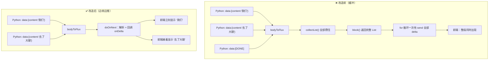

# 把"假流式"改成真流式：Flux 边收边推 — 学习笔记

> 日期：2026-09-29
> 关联每日总结：[daily.md](daily.md)
> 关联笔记：[java-python-agent-http.md](java-python-agent-http.md)
> 关联代码：`AgentChatClient.java`、`AgentController.java`、`AgentChatService.java`

## 一、核心概念

### 问题：传输层是流式，用户体验却不是

改造前，整条链路的**每个环节都是流式的**：

- Python 侧用 SSE 一段段吐字 ✅
- Java 侧用 `WebClient` + `Flux<String>` 接收 ✅
- Java 对前端用 `SseEmitter` / WebSocket 推送 ✅
- 前端有打字机逻辑和闪烁光标 ✅

但用户实际看到的是：**转圈等几秒 → 整段答案"啪"地一起出现**。

原因就在 `AgentChatClient` 这一行：

```java
.bodyToFlux(String.class)
.timeout(READ_TIMEOUT)
.collectList()          // ← 元凶：把整条流"攒"成一个 List
.block(TOTAL_TIMEOUT);  // ← 攒完才返回
```

**`collectList()` 把"流"重新变成了"一次性结果"**。它要等上游（Python 的 SSE 流）全部结束，才把收集到的所有元素作为一个 `List` 交给下游。于是 Java 一直憋着，等 Python 说完最后一句话，才 `return`；之后 `AgentController` 再 `for (delta : deltas) emitter.send(...)` 一次性全发出去。

**结论：`Flux` 只是"能流式"，用不用得看你怎么消费。** `collectList()` 是把流式能力主动放弃掉的写法。

### 关键认知

| | 描述的是 | 不代表 |
|---|---|---|
| "用了 SSE" | 传输**格式** | 用户能看到逐字效果 |
| "用了 Flux" | 具备**能力** | 数据真的边到边处理了 |

真正决定体验的是：**数据处理链路上有没有缓冲点**。任何一处 `collectList()` / `collect()` / 攒 `StringBuilder` 到最后才发，都会让流式失效。

## 二、原理与流程



## 三、改造方案

### 1. 加一个 `onDelta` 回调参数

核心思路：**不再"返回收集好的结果"，而是"每来一段就交出去一次"**。同时内部继续累积一份完整文本，供落库使用。

```java
// 保留旧签名，向后兼容（6 参重载委托给 7 参）
public ChatCallResult call(Long userId, Long coupleId, String sessionId,
                           String message, String scope, Long scopeId) {
    return call(userId, coupleId, sessionId, message, scope, scopeId, null);
}

/** @param onDelta 每解析出一段增量就立即回调（可为 null） */
public ChatCallResult call(Long userId, Long coupleId, String sessionId,
                           String message, String scope, Long scopeId,
                           Consumer<String> onDelta) {
    List<String> deltas = new ArrayList<>();      // 仍累积，供 fullText() 落库
    List<Map<String, Object>> refs = new ArrayList<>();
    List<String> errorHolder = new ArrayList<>();

    client.post().uri("/v1/chat")
        ...
        .bodyToFlux(String.class)
        .timeout(READ_TIMEOUT)
        .publishOn(Schedulers.boundedElastic())   // ← 见下文说明
        .doOnNext(block -> consumeData(block, deltas, refs, errorHolder, onDelta))
        .then()                                   // ← 只要"完成信号"，不要结果集合
        .block(TOTAL_TIMEOUT);
    ...
}
```

三个改动点：

- **`doOnNext` 替代"return 后遍历"**：元素**到达时**就处理，而不是等收集完再遍历；
- **`.then()` 替代 `.collectList()`**：`collectList()` 返回 `Mono<List<String>>`（要等全部收完才发这一个元素）；`.then()` 返回 `Mono<Void>`，只等**完成信号**，中间元素已经被 `doOnNext` 消费掉了；
- **`deltas` 列表保留**：既推给前端，又攒下来用于 `fullText()` 落库——**推流和落库互不冲突**。

### 2. 为什么要 `publishOn(boundedElastic())`

`WebClient` 基于 Reactor Netty，解码（`doOnNext`）默认跑在 **Netty 的事件循环线程**上。而 `doOnNext` 里要做的事是**阻塞 IO**（`SseEmitter.send()` 写 socket、WebSocket `sendMessage()`）。

> **Netty 事件循环线程绝不能被阻塞**——它是少数几个线程，同时服务着所有连接。一旦被某个请求的 IO 卡住，其它连接的读写都会被拖累。

`publishOn(Schedulers.boundedElastic())` 的作用是：**把下游操作符切换到弹性线程池执行**。这样 `doOnNext`（以及里面的回调）就跑在专门的弹性线程上，事件循环只管收数据。

```java
.timeout(READ_TIMEOUT)                     // 仍在事件循环：只做计时，不阻塞
.publishOn(Schedulers.boundedElastic())    // 从这里开始切换到弹性线程池
.doOnNext(...)                             // 阻塞 IO 在这里执行，安全
```

顺带一个线程安全点：`deltas` 由弹性线程写入、由调用线程在 `block()` 返回后读取。`block()` 的完成语义建立了 **happens-before**，所以无需加锁。

### 3. 回调抛异常绝不能中断整条流

推送目标（浏览器）可能中途断开：`emitter.send()` 会抛 `IOException`，WebSocket 发送也可能失败。如果让异常冒泡进 `doOnNext`，**整条 Flux 会立刻报错终止**，后面的内容全丢。

所以回调必须"吞掉"异常：

```java
private void emit(Consumer<String> onDelta, String delta) {
    if (onDelta == null) return;
    try {
        onDelta.accept(delta);
    } catch (Exception e) {
        log.debug("增量下发失败（客户端可能已断开）: {}", e.getMessage());
        // 只记日志：已经收到的内容照常累积，流继续走完
    }
}
```

同样的保护也加在两端：`AgentController.send()` 和 `consumeData` 里的两次 `emit` 调用。

## 四、两条链路怎么接

### 链路 C：`/ai` 页（SSE）

```java
AgentChatClient.ChatCallResult result = agentChatClient.call(
        userId, coupleId, "user" + userId, request.getMessage(),
        "personal", userId,
        delta -> send(emitter, Map.of("delta", delta)));   // ← 立刻下发
```

改造前是"先 `call()` 拿完整结果，再 `for` 循环发"；现在是**拿到一段发一段**。

失败时的语义也顺势理顺了：如果已经推过部分内容，前端会**保留已显示的部分**，只补一条 `error` 事件（前端仅在正文为空时才展示错误），不会再出现"内容已经显示了却又弹错误"的割裂感。

### 链路 D：聊天 `@bot`（WebSocket）

这里多了一层考虑：**落库要存什么？**

改造前：失败就存一句降级文案（因为根本没有部分内容）。
改造后：可能已经推了一半内容给用户——如果这时只存降级文案，**用户看到的和数据库里存的就对不上了**。所以用 `StringBuilder` 累积"已经推出去的内容"，失败时以它为准：

```java
StringBuilder streamed = new StringBuilder();

AgentChatClient.ChatCallResult result =
        agentChatClient.call(userId, coupleId, sessionId, userMessage, scope, scopeId,
                delta -> {
                    streamed.append(delta);
                    pushDelta(pusher, agentMsgId, delta);   // 边收边推
                });

if (!result.isOk()) {
    boolean nothingStreamed = streamed.length() == 0;
    // 已推过的部分优先落库；一个字都没产出时才用降级文案
    String text = nothingStreamed ? fallbackText(result.getErrorType()) : streamed.toString();
    MessageVO vo = chatService.save(coupleId, userId, "AGENT", text, agentMsgId, true);
    pushFinal(pusher, agentMsgId, vo, nothingStreamed ? text : null);
    return;
}
// 成功：结果一致，用 ChatCallResult.fullText() 落库
```

原则：**用户看到什么，历史记录里就存什么**。

## 五、改造前后对比

| 维度 | 改造前 | 改造后 |
|---|---|---|
| 消费方式 | `collectList().block()` 攒完再返回 | `doOnNext` 到达即处理 |
| 返回类型 | `Mono<List<String>>` | `Mono<Void>`（只等完成信号） |
| 前端体验 | 转圈 → 整段出现 | 逐字出现 |
| 落库内容 | 完整文本 | 完整文本（失败时存"已推部分"） |
| 回调线程 | —（无回调） | `boundedElastic` 弹性线程池 |
| 客户端断开 | —（无影响） | 回调异常被吞，不影响流与落库 |
| 失败语义 | 直接给降级文案 | 有部分内容就保留，无内容才降级 |
| 接口兼容 | — | 保留 6 参重载，旧调用方不受影响 |

## 六、我的思考

> _这次最大的认知升级是：**"用了流式技术"和"实现了流式体验"是两件事**。改造前每个组件单独看都是流式的，SSE 是、`Flux` 是、`SseEmitter` 也是，但 `collectList()` 这一个词就把整条链路的努力抹掉了。_
>
> _更深一层的体会是：**流式的敌人不是"某个 API 用错了"，而是链路上任何一个缓冲点**。回头看，`AgentChatService` 里那个 `for (delta : result.getDeltas())` 循环、以及失败时"只存降级文案"的逻辑，本质上都是同一个错误假设的产物——"结果是一个整体"。一旦改成"结果是陆续到来的"，这两处就自然要跟着改。_
>
> _另外 `publishOn` 这个点让我第一次真正意识到"响应式"不只是写法问题：把阻塞 IO 放在 Netty 事件循环上是个**隐患**，平时不报错，但在并发下会拖慢所有连接。这种"能跑但有隐患"的地方，是静态读代码时最容易漏掉的。_

## 七、规范总结

- **流式消费三件套**：`doOnNext`（到达即处理）+ `.then()`（只等完成）+ 不用 `collectList()`
- **推流与落库分离**：回调负责"立刻给用户"，累积列表负责"完整落库"，二者并存
- **回调必须容错**：客户端断开的异常不能让整条流终止
- **阻塞 IO 必须切线程**：`publishOn(Schedulers.boundedElastic())`，绝不阻塞 Netty 事件循环
- **落库以用户所见为准**：中途失败时存已推内容，而不是降级文案
- **改造保持兼容**：加参数用重载，旧调用方零改动
- **判断有没有缓冲点**：搜 `collectList` / `collect(` / `StringBuilder` 到最后才发

## 八、延伸 / 待验证

- **端到端效果未实测**：Python 服务尚未编写，本次只验证了**改造后能通过编译**（在临时目录 `mvn -o compile` 通过）。真实逐字效果需等 Python 侧 `/v1/chat` 能按 SSE 契约输出后才能确认；
- 前端 `Chat.vue` 的打字机/闪烁光标逻辑之前是"装饰性"的（因为内容一次到齐），改造后应能真正生效，值得实际观察一次；
- `publishOn` 的默认预取量为 256：若 Python 在极短时间内吐出超过 256 个片段，会触发背压暂停上游，属于正常行为，但可以在压测时留意；
- 可考虑进一步：把 `refs` 也改成"边检索边下发"，让引用出处更早出现在界面上；
- 前端目前**不发心跳帧**，而服务端 90s 无上行文本帧就关闭连接——与本次改造无关，但同属"聊天体验"的遗留问题。
