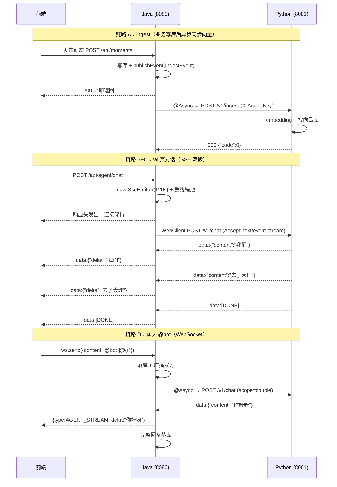

# Java ↔ Python 服务间调用（HTTP 请求 / SSE 流式） — 学习笔记

> 日期：2026-09-29
> 关联每日总结：[daily.md](daily.md)
> 关联代码：`backend/src/main/java/com/couple/agent/`、`backend/src/main/java/com/couple/chat/agent/`
> 关联契约：[docs/agent-api.md](../../docs/agent-api.md)、[docs/api-contract.md](../../docs/api-contract.md) §9 / §10

## 一、核心概念

### 1. 这是"服务间调用"，不是"请求转发"

一开始容易把它理解成"转发"（forward / proxy），但两者完全不同：

| | 转发 / 代理 | 本项目的做法（服务间调用） |
|---|---|---|
| 谁发起 | 收到请求后**原样转给**后端 | Java **主动发起**一次**全新**的 HTTP 请求 |
| 请求体 | 通常是同一个请求 | Java 自己组装 body、自己加 header |
| 前端感知 | 前端只跟一个入口说话 | 前端**永远不知道** Python 存在 |

关键设计：**Python 只在内网，不暴露公网**。前端只认 Java，Python 是 Java 的"下游能力提供方"。这样做的收益是——Python 挂了、没部署、超时，都不影响主业务（登录、动态、相册照常可用），只是 AI 相关入口返回降级文案。

### 2. 两条链路，两套技术选型

项目里 Java → Python 有**两条独立链路**，选型完全不同，这是最容易混的地方：

| | 链路 A：**ingest**（数据同步） | 链路 B：**对话**（chat） |
|---|---|---|
| 目的 | 把动态/照片文本同步进向量库 | 让 AI 基于这些数据回答问题 |
| Java 客户端 | `RestTemplate`（阻塞式） | `WebClient`（响应式） |
| 响应形态 | 普通 JSON，一次返回 | **SSE 流**，边生成边吐 |
| 失败处理 | 重试 3 次 | 熔断 + 降级文案 |
| 触发时机 | 业务写库后**异步** | 用户点击/发消息时 |
| 契约 | `POST /v1/ingest` | `POST /v1/chat` |

**为什么对话必须用 `WebClient`**：`RestTemplate` 是阻塞的，调下去就卡住等 Python 全部生成完；而 LLM 生成一段话要好几秒，用 `RestTemplate` 就只能"等它全说完再一次性拿到"，流式就失去意义。`WebClient` 返回的是 `Flux<String>`——"未来会陆续到达的一串数据"，可以边到边处理。

### 3. 鉴权用共享密钥，不是 JWT

项目的用户体系用 JWT，但 Java → Python 用的是固定共享密钥 `X-Agent-Key`：

- **JWT 证明的是"某个用户是谁"**（用户身份）
- **`X-Agent-Key` 证明的是"你确实是那个 Java 后端"**（服务身份）

两者语义不同，不能混用。密钥两边配置一致即可，Python 侧校验 `X-Agent-Key` 头。

### 4. 还有两条"Java → 前端"的链路（别和上面混）

Java 拿到 Python 的结果后，要用**前端能吃的格式**再发一次，这两条链路跟 Python 无关：

| | 链路 C：`/ai` 页 | 链路 D：聊天内 `@bot` |
|---|---|---|
| Java 对前端 | `SseEmitter`（SSE） | WebSocket 广播 |
| 帧格式 | `data:{"delta":"..."}` | `{"type":"AGENT_STREAM","delta":"..."}` |
| 是否落库 | 否（前端存 localStorage） | 是（`type=AGENT` 消息） |

所以 Java 在整条链里扮演了**双向协议转换器**：对 Python 是 SSE **客户端**，对前端是 SSE / WebSocket **服务端**。

## 二、原理与流程



### 链路 A 代码走读

```
业务 Service（如 AlbumServiceImpl 上传照片）
  └─ publishEvent(new IngestEvent("photo", 88, "相册名 描述", "couple", coupleId, "upsert"))
       ↓
  IngestEventListener.onIngest()        ← @Async + @TransactionalEventListener(AFTER_COMMIT)
       ↓
  AgentClient.send(bizType, bizId, content, scope, scopeId, action)
       ├─ 1. agent.enabled=false ? 直接 return            ← 总开关，静默跳过
       ├─ 2. 幂等去重：key = "photo:88:upsert"，5s 内重复则跳过
       ├─ 3. 拼 body（LinkedHashMap，字段名严格对齐契约）
       ├─ 4. 装 header：Content-Type + X-Agent-Key
       └─ 5. for 循环 3 次：agentRestTemplate.postForEntity(url, entity, String.class)
```

### 链路 B 代码走读

```
AgentChatClient.call(userId, coupleId, sessionId, message, scope, scopeId, onDelta)
  ├─ 1. agent.enabled=false → 返回 DISABLED
  ├─ 2. 熔断中（30s 窗口内）→ 返回 CIRCUIT_OPEN，不真发请求
  ├─ 3. 组装 body（trace_id / user_id / couple_id / session_id / message / scope / scope_id）
  ├─ 4. buildWebClient()：连接超时 3s（Netty CONNECT_TIMEOUT_MILLIS）
  │                     读超时 30s（responseTimeout）
  └─ 5. post("/v1/chat")
           .accept(TEXT_EVENT_STREAM)
           .retrieve().bodyToFlux(String.class)     ← 把响应体当"一串 String"
           .timeout(READ_TIMEOUT)                   ← 块与块之间超时
           .publishOn(boundedElastic())             ← 回调里有阻塞 IO，切线程
           .doOnNext(block -> consumeData(..., onDelta))   ← 每块立刻解析 + 回调
           .then().block(TOTAL_TIMEOUT)             ← 整体最多等 35s
```

## 三、关键技术点

### 1. `.timeout()` 是"元素间隔"超时，不是总超时

这是很容易理解错的一点。对 `Flux` 调 `.timeout(30s)` 的语义是：**如果超过 30s 没有下一个元素到达就报错**。所以它约束的是"Python 别憋着不说话"，正好对应契约里"尽快 flush"的要求。真正的**总超时**是 `.block(35s)`。

### 2. `bodyToFlux(String.class)` 会自动剥掉 `data:` 前缀

Spring 识别到响应 `Content-Type: text/event-stream` 后，会用 SSE 解码器把每个事件的 `data` 字段**提取出来**。所以拿到的 `String` 通常是 `{"content":"我们"}` 而不是 `data:{"content":"我们"}`。

代码里 `consumeData()` 对两种形态都兼容（`t.startsWith("data:")` 才截断），这样即使换别的客户端/网关也不会突然解析失败。

```java
// 解析优先级：JSON 里的 content / error / refs
try {
    JsonNode node = objectMapper.readTree(data);
    if (node.get("content") != null) { deltas.add(...); emit(onDelta, ...); }
    ...
} catch (Exception ignore) {
    deltas.add(data);        // 不是 JSON → 当纯文本增量，照样能用
    emit(onDelta, data);
}
```

### 3. `@Async` + 线程池：别占着用户请求线程

同步调 Python 要几百毫秒到几十秒。`@Async` 让方法丢到线程池执行：

```java
@Bean(name = "agentExecutor") @Primary
public Executor agentExecutor() { corePoolSize=2, maxPoolSize=8, queueCapacity=200, 线程名前缀 "agent-sse-" }
```

单独建池而不是用默认池，好处是**可观测**（日志线程名一眼看出是 AI 相关）和**可隔离**（AI 慢不会拖垮别的异步任务）。`@Primary` 是为了消除"存在多个 TaskExecutor 但没指定默认"的启动警告。

### 4. 事务事件：先提交，再同步

如果事务还没提交就去通知 Python，Python 可能拿到一条**最终被回滚掉的脏数据**。所以用事件解耦：

```java
@Async
@TransactionalEventListener(phase = TransactionPhase.AFTER_COMMIT, fallbackExecution = true)
public void onIngest(IngestEvent event) { ... }
```

- `AFTER_COMMIT`：等事务提交成功才执行；
- `fallbackExecution = true`：**万一本方法压根没开事务，也照样立即执行**。这一条很关键——`MomentServiceImpl.publish` 其实没加 `@Transactional`，如果没这个开关，事件会被**静默丢弃**，向量库永远同步不上。

### 5. SSE 的格式规范

```
data: {"content":"我们"}      ← 每行以 data: 开头
                              ← 空行 = 一个事件结束（即 \n\n）
data: [DONE]                  ← 约定的结束标记
```

规矩只有两条：**`data:` 前缀** + **空行分隔**。少了空行，客户端会把多个事件粘成一条；少了 `[DONE]`，客户端只能等连接关闭才知道结束。

### 6. `SseEmitter`：一次请求，慢慢回

Spring MVC 里接口方法正常是"返回对象、立刻结束"。要流式返回必须用 `SseEmitter`：

```java
SseEmitter emitter = new SseEmitter(120_000L);  // 超时保护
agentExecutor.execute(() -> {                    // 业务挪到别的线程
    ...
    emitter.send(SseEmitter.event().data(Map.of("delta", delta)));
    emitter.send(SseEmitter.event().data("[DONE]"));
    emitter.complete();                          // 显式关闭
});
return emitter;                                  // 立刻返回，但 HTTP 连接保持打开
```

要点：`return emitter` 时响应头就发出去了，连接保持；后续在**别的线程**里持续 `send`。所以 `emitter` 会被跨线程使用。

### 7. 熔断：别让用户陪着一起等

```java
if (circuitOpen) {
    if (now - circuitOpenedAtMs > CIRCUIT_OPEN_MS) circuitOpen = false; // 半开：放一次试探
    else return ChatCallResult.error("CIRCUIT_OPEN", "熔断中");          // 直接返回，不发请求
}
```

连续失败 5 次就打开熔断，30s 内**直接返回降级文案**，不再真发请求。意义是：Python 挂了的时候，别让每个用户请求都傻等 35 秒。30s 后进入"半开"状态放一次试探，成功就恢复正常。

### 8. 降级文案：无论如何都有话说

`DISABLED` / `CIRCUIT_OPEN` / `UNREACHABLE` / `TIMEOUT` / `FAILED` 五类错误，各对应一句中文文案，且**降级文案也会落库**——这样用户翻聊天记录时，能看到当时 AI 到底回了什么，而不是一片空白。

## 四、Python 端要实现什么

Python 端**尚未编写**，只有契约。需要实现 3 个接口（FastAPI 骨架）：

```python
from fastapi import FastAPI, Header, HTTPException
from fastapi.responses import StreamingResponse
import json, os

app = FastAPI()
AGENT_KEY = os.getenv("AGENT_KEY", "change-me")

def check_key(x_agent_key: str | None):
    if x_agent_key != AGENT_KEY:
        raise HTTPException(status_code=401, detail="bad key")   # 401 = 密钥错误

@app.get("/v1/health")
def health(x_agent_key: str | None = Header(default=None)):
    check_key(x_agent_key)
    return {"code": 0, "message": "ok", "data": None}

@app.post("/v1/ingest")
def ingest(payload: dict, x_agent_key: str | None = Header(default=None)):
    check_key(x_agent_key)
    ns = f"moment_c{payload['scope_id']}" if payload["scope"] == "couple" \
         else f"note_u{payload['scope_id']}"
    if payload["action"] == "delete":
        vector_store.delete(namespace=ns, biz_id=payload["biz_id"])
    else:
        vector_store.upsert(namespace=ns, biz_id=payload["biz_id"],
                            vector=embed(payload["content"]),
                            metadata={"biz_type": payload["biz_type"],
                                      "biz_id": payload["biz_id"],
                                      "scope": payload["scope"],
                                      "scope_id": payload["scope_id"],
                                      "content": payload["content"]})
    return {"code": 0, "message": "success", "data": None}   # 必须 200

@app.post("/v1/chat")
def chat(payload: dict, x_agent_key: str | None = Header(default=None)):
    check_key(x_agent_key)

    def gen():
        try:
            docs = retrieve(payload["message"], payload["scope"], payload["scope_id"])
            for chunk in llm_stream(payload["message"], docs):
                yield f"data: {json.dumps({'content': chunk}, ensure_ascii=False)}\n\n"
            if docs:
                refs = [{"biz_type": d["biz_type"], "biz_id": d["biz_id"],
                         "title": d.get("title", "")} for d in docs]
                yield f"data: {json.dumps({'refs': refs}, ensure_ascii=False)}\n\n"
        except Exception as e:
            yield f"data: {json.dumps({'error': str(e)}, ensure_ascii=False)}\n\n"
        finally:
            yield "data: [DONE]\n\n"          # 必须发

    return StreamingResponse(gen(), media_type="text/event-stream")
```

**Python 侧必须记住的 5 条**：

1. `Content-Type: text/event-stream`（靠 `StreamingResponse(media_type=...)`）；
2. 每行 `data: <json>\n\n`——**两个换行**才算一个事件结束；
3. 增量字段名是 **`content`**（`delta` 是 Java 转发给前端时才改的名，别搞混）；
4. 结尾必须发 **`data: [DONE]`**，Java 靠它判断流结束；
5. **尽快 flush**，别把内容攒到最后一次性 yield（否则前面链路修好了也白搭）。

启动与自测：

```bash
uvicorn main:app --host 0.0.0.0 --port 8001

# 关掉 curl 缓冲，应该看到 data: 一行行冒出来
curl -N -X POST http://localhost:8001/v1/chat \
  -H "X-Agent-Key: change-me" -H "Content-Type: application/json" \
  -d '{"trace_id":"abc","user_id":1,"couple_id":1,"session_id":"user1",
       "message":"你好","scope":"personal","scope_id":1}'
```

## 五、我的思考

> _最开始的困惑是"Java 到底怎么把请求转给 Python 的"。理清之后最大的收获是：**这不是转发，而是 Java 作为客户端主动发起一次新请求**，Python 是内网里的独立服务，前端根本不知道它存在。_
>
> _第二个认知转折是技术选型：同一个 Java 服务里，ingest 用 `RestTemplate`、chat 用 `WebClient`，一开始觉得"重复造轮子"，后来明白**阻塞式客户端在语义上就做不了流式**——它只能等 body 全部结束才返回。选型不是风格问题，是能力问题。_
>
> _第三个收获是关于"降级"：以前觉得 Python 没部署是"功能没做完"，现在理解这是一种**刻意的架构设计**——把外部依赖的可失败性当成一等公民，用 `agent.enabled` 开关、超时、熔断、静态文案四层把它隔离在核心业务之外。_

## 六、规范总结

- **服务间调用而非转发**：Java 主动发起，Python 内网隔离，前端无感知
- **客户端选型看语义**：一次性请求 → `RestTemplate`；流式 → `WebClient` + `Flux`
- **鉴权分层**：用户身份用 JWT，服务身份用共享密钥 `X-Agent-Key`
- **异步三件套**：`@Async`（不占请求线程）+ 专用线程池（可观测/隔离）+ `@Primary`（消除歧义）
- **事务与外部调用解耦**：`AFTER_COMMIT` 保证不发出脏数据；`fallbackExecution=true` 保证无事务场景不丢事件
- **SSE 两条铁律**：`data:` 前缀 + 空行分隔；结束必须发 `[DONE]`
- **超时分两层**：元素间隔超时（`.timeout`）防"卡住不吐"，总超时（`.block`）兜底
- **可失败依赖四层防护**：开关 → 超时 → 熔断 → 降级文案（且降级文本要落库）
- **流式传输 ≠ 流式体验**：见 [agent-streaming-refactor.md](agent-streaming-refactor.md)

## 七、延伸 / 待验证

已核对出的实现偏差（详见 [docs/agent-api.md](../../docs/agent-api.md) §7）：

- `AgentClient` 的 `RestTemplate` 是裸 `new RestTemplate()`，**没有配任何超时**；文档里"普通请求连接 3s"实际只存在于对话客户端；
- ingest 重试**不区分错误码**（401/400 也会重试 3 次），且 `RETRY_DELAYS_MS` 里的第三个 2min 因 `if (attempt < length - 1)` 永不生效，实际只等 5s / 30s；
- `AgentClient.recentCalls` 去重 Map **只写不清理**，长期运行会单调增长；
- `AgentChatClient.handleFailure` 用 `instanceof TimeoutException` 判定超时，但 Reactor 的 `.timeout()` / `.block()` 会把超时异常**包一层**（`ReactiveException` / `IllegalStateException`），可能导致超时被误判为 `UNREACHABLE`（两者文案相同，用户无感但归因不准）；
- 当前只有 `moment` / `photo` 两个 `biz_type` 有发布点，`note` 仍是纯预留。
